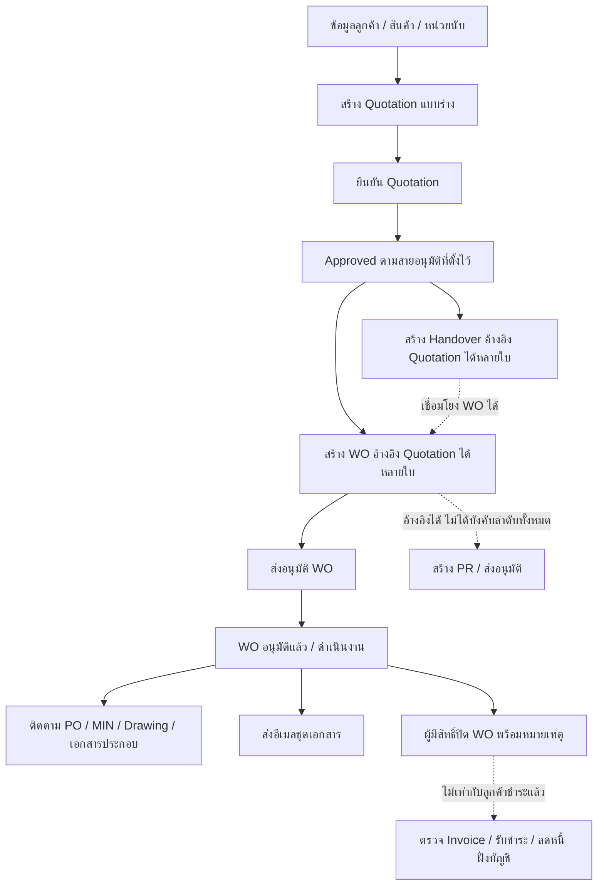
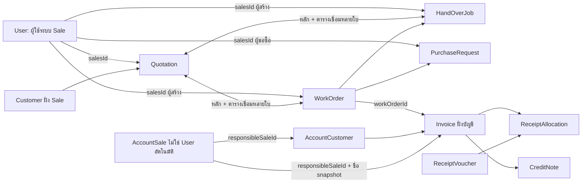
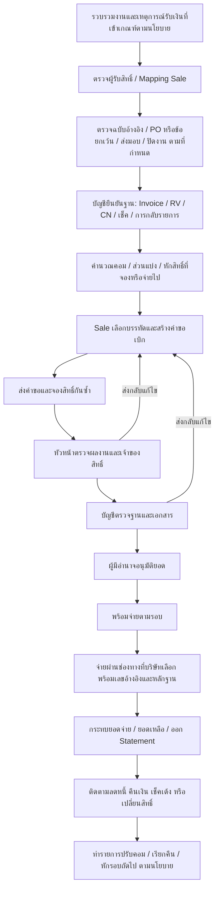

# ระบบ Sale ปัจจุบัน และข้อมูลสำหรับออกแบบ Flow เบิกค่าคอมมิชชัน

**วันที่สำรวจ:** 17 พฤศจิกายน 2026  
**สถานะ:** เอกสาร As-is จาก source code ใน working tree ไม่ใช่ผล UAT บนระบบ Production  
**วัตถุประสงค์:** รวบรวมฟีเจอร์ Sale ให้ครบตามหน้าจอหลัก พร้อมแยกข้อมูลที่ใช้ประกอบการเบิกค่าคอมได้ สิ่งที่ยังขาด และข้อเสนอ Flow สำหรับหารือกับฝ่ายขาย/บัญชี

> **ข้อสรุปสำคัญ:** ระบบมีใบเสนอราคา ใบสั่งงาน ส่งมอบงาน ใบขอซื้อ การอนุมัติ เอกสารแนบ อีเมล และรายงานแล้ว แต่ยังไม่พบโมดูลคำนวณ/ตั้งเบิก/อนุมัติ/บันทึกจ่ายค่าคอมมิชชันโดยเฉพาะ ยอดขายในรายงาน Sale และสถานะปิด WO **ไม่ใช่หลักฐานว่ารับชำระเงินจริงแล้ว**

## สารบัญ

- [1. Scope Baseline — ขอบเขตและวิธีสำรวจ](#scope)
- [2. ภาพรวมระบบและ Flow ที่มีจริง](#overview)
- [3. User Scenarios & Testing — เส้นทางผู้ใช้](#scenarios)
- [4. Requirements — บัญชีฟีเจอร์ปัจจุบัน](#features)
- [5. Key Entities — ข้อมูลและความสัมพันธ์](#entities)
- [6. Success Criteria — เกณฑ์ใช้เอกสารและข้อจำกัดการยืนยัน](#criteria)
- [7. ความพร้อมสำหรับเบิกค่าคอม และช่องว่าง](#readiness)
- [8. ข้อเสนอ Flow เบิกค่าคอม — ยังไม่มีในระบบ](#proposed-flow)
- [9. เรื่องที่ต้องตกลงกับฝ่ายธุรกิจก่อนพัฒนา](#decisions)
- [10. กรณีทดสอบสำหรับ Flow ค่าคอมในอนาคต](#commission-tests)
- [11. แหล่งอ้างอิงจาก source code](#sources)

<a id="scope"></a>
## 1. Scope Baseline — ขอบเขตและวิธีสำรวจ

### 1.1 วิธีสำรวจ

- อ่านเมนูและหน้าจอ Sale ใน [ui](../ui/src/app/), API ที่หน้าจอเรียก, กฎสิทธิ์/อนุมัติ, และโครงสร้างข้อมูลใน [schema](../api/prisma/schema.prisma)
- เทียบปุ่มบนหน้าจอกับ endpoint จริง ไม่ถือว่ามี endpoint แล้วผู้ใช้จะทำงานครบผ่าน UI ได้เสมอ
- ตรวจจุดต่อบัญชีเฉพาะที่เกี่ยวกับเจ้าของยอดขาย ใบแจ้งหนี้ การรับเงิน ลดหนี้ และการจ่ายเงิน
- ใช้โค้ดปัจจุบันเป็นหลัก ไม่ใช้ชื่อเมนู ข้อความโฆษณาฟีเจอร์ หรือเอกสารออกแบบเก่าเป็นหลักฐานว่าทำได้แล้ว
- ไม่เข้าฐานข้อมูล ไม่ส่งอีเมล ไม่แก้ข้อมูลธุรกิจ และไม่ได้ทดสอบผ่านระบบที่ deploy อยู่
- ไม่พบ constitution, clarification หรือชุด research มาตรฐานที่ต้องนำมาใช้กำกับการสำรวจครั้งนี้

### 1.2 ขอบเขตที่นับว่าครอบคลุม

ตรวจครอบคลุม **19 เมนูใน Sidebar และ 1 กลุ่ม Profile/บัญชีผู้ใช้ รวม 20 กลุ่มฟังก์ชัน**:

1. Dashboard
2. Quotation
3. Work Order
4. Send email work orders
5. Handover
6. Purchase Request
7. Pending Approvals
8. Reports รวม 7 หน้าย่อย
9. Customers
10. Products
11. Units
12. Users
13. Approval Flow
14. PR Types
15. Roles & Permissions รวมการตั้งค่าสิทธิ์เมนู
16. Audit Log
17. Activity Log
18. Email Log
19. System Settings
20. Profile/บัญชีผู้ใช้

Sidebar แบ่งเป็น **8 เมนูหลัก + 3 ข้อมูลหลัก + 8 ผู้ดูแล**; Reports มีอีก 7 หน้าย่อยที่รวมอยู่ในขอบเขตนี้

ขอบเขตเพิ่มเติม: งานสนับสนุนร่วม เช่น แนบไฟล์/PDF/เลขเอกสาร/แจ้งเตือน และจุดเชื่อมบัญชีที่มีผลต่อค่าคอม

**นอกขอบเขต:** สำรวจบัญชี/สต็อกทุกฟีเจอร์, ระบบ CRM ที่ไม่ได้ปรากฏใน Sale UI ปัจจุบัน, การยืนยันค่าตั้งจริงของบริษัท, การกำหนดสูตรค่าคอมแทนผู้บริหาร และการพัฒนาโมดูลใหม่ เอกสารไม่ได้ถือหน้า HTML demo/SPA รุ่นเดิมเป็นหลักฐานเทียบเท่า UI ปัจจุบัน

### 1.3 วิธีอ่านสถานะความสามารถ

| ป้าย | ความหมาย |
|---|---|
| UI + API | พบทั้งหน้าจอใช้งานและโค้ดรองรับ ไม่ได้หมายถึงผ่าน UAT แล้ว |
| API / ข้อมูล | มี endpoint หรือช่องเก็บข้อมูล แต่ยังไม่พบขั้นตอนบนหน้าจอครบ |
| ตามค่าตั้ง | ผลจริงขึ้นกับบทบาท สิทธิ์เมนู สายอนุมัติ หรือการเชื่อมต่อที่บริษัทตั้งไว้ |
| ยังไม่พบ | ไม่พบในโค้ดที่สำรวจ ไม่ใช่คำรับรองว่าไม่มีในระบบภายนอก/งาน manual |
| ข้อเสนอ | สิ่งที่เสนอให้ทำในอนาคต ไม่ใช่ฟีเจอร์ปัจจุบัน |

รหัส **REQ-001 ถึง REQ-060** ในหัวข้อ 4 เป็นรหัสติดตามความสามารถที่พบ ไม่ใช่คำสั่งให้พัฒนาฟีเจอร์เหล่านี้ใหม่

<a id="overview"></a>
## 2. ภาพรวมระบบและ Flow ที่มีจริง

### 2.1 ระบบ Sale ใช้ทำอะไร

ระบบเน้น **เอกสารขายและประสานงานโครงการ** ตั้งแต่เสนอราคา เปิดงาน ขอซื้อ ส่งมอบ ติดตาม PO และปิดงาน มีการส่งอนุมัติแยกตามประเภทเอกสาร และส่งชุดเอกสาร WO ทางอีเมลได้

ยังไม่พบหน้าจอเฉพาะสำหรับ Lead, Opportunity, Sales activity, Sales target หรือ Commission ในชุดเมนูปัจจุบัน จึงไม่ควรตีความว่าเป็น CRM/ระบบจ่ายผลตอบแทนฝ่ายขายครบวงจร

### 2.2 Flow เชิงธุรกิจที่ระบบรองรับ



**ข้อควรเข้าใจเกี่ยวกับ Flow นี้**

- ไม่ใช่สายพานที่ทุกงานต้องเดินครบทุกจุด: WO สร้างโดยไม่ผูก Quotation ได้; PR ไม่บังคับว่าต้องมี WO; Handover ไม่บังคับว่าต้องเริ่มจาก WO
- หน้าสร้าง WO/Handover เลือก Quotation ที่อนุมัติแล้ว และเลือกได้มากกว่า 1 ใบ; ใบแรกเป็นเอกสารอ้างอิงหลัก ส่วนใบเพิ่มเติมอยู่ในตารางเชื่อม
- Handover ที่สร้างจาก Quotation สามารถถูกเชื่อมไปยัง WO active ล่าสุดของ Quotation หลักโดยอัตโนมัติ จึงมีกรณีสร้าง Handover ก่อน WO หรือผูกภายหลัง
- การอนุมัติ PR เป็นเรื่องขอซื้อ ไม่ใช่หลักฐานต้นทุนจริงหรือจ่ายเงินจริงครบแล้ว
- การปิด WO ตรวจสถานะอนุมัติ สิทธิ์ผู้ปิด และหมายเหตุ ไม่ได้ตรวจว่ามี PO, Handover อนุมัติ, Invoice หรือรับเงินครบทุกอย่างแล้ว
- ไม่มีเหตุการณ์ “ปิดงานแล้วสร้างใบเบิกค่าคอมอัตโนมัติ” ในโค้ดที่สำรวจ

หลักฐาน: [S01](#s01), [S05](#s05), [S07](#s07), [S09](#s09), [S11](#s11)

<a id="scenarios"></a>
## 3. User Scenarios & Testing — เส้นทางผู้ใช้

ตารางนี้เป็นแนวทางตรวจยืนยัน As-is ไม่ใช่รายงานว่าทดสอบผ่านแล้ว

| ลำดับ | ผู้ใช้/เป้าหมาย | Given → When → Then ที่ควรตรวจ |
|---|---|---|
| P1-1 | Sale จัดทำราคา | มีข้อมูลลูกค้าและรายการ → สร้าง/แก้ไขแบบร่าง ใส่ค่าวัสดุ ค่าแรง รายละเอียดย่อย ส่วนลด VAT → บันทึกยอดและพิมพ์ใบเสนอราคาได้ |
| P1-2 | Sale ยืนยันข้อเสนอ | มี Quotation draft → กดยืนยัน → ถ้าสายอนุมัติว่างจะ approved; ถ้ามีสายจะ pending ตามค่าตั้ง ไม่ใช่สถานะลูกค้าตอบรับ |
| P1-3 | Sale เปิดงาน | มี Quotation approved หนึ่งหรือหลายใบ → เลือกสร้าง WO → รายการถูกนำมารวมและมีอ้างอิงเอกสารหลัก/เพิ่มเติม |
| P1-4 | ผู้อนุมัติส่งงานต่อ | WO pending อยู่ในขั้นของตน → อนุมัติพร้อมความเห็น หรือ reject → เดินขั้นถัดไป/จบสาย หรือกลับให้เจ้าของแก้ไข |
| P1-5 | ผู้ประสานงานติดตาม PO | WO approved และผู้ใช้มีสิทธิ์จัดการไฟล์หลังอนุมัติ → แนบ PO พร้อมยอด → แสดงมี PO และบันทึกประวัติ; ไม่เกิดยอดรับชำระบัญชี |
| P1-6 | ผู้มีสิทธิ์ปิดงาน | WO approved → ระบุหมายเหตุและปิด → เก็บวันปิด/ผู้ปิด/ประวัติ โดยยังต้องตรวจการรับเงินจริงแยกต่างหาก |
| P2-1 | Sale จัดทำส่งมอบ | เลือก Quotation หรือกรอกงานเอง → สร้าง Handover พร้อมรายการ → ได้เอกสาร draft และพรีวิว/PDF; การส่งอนุมัติผ่าน UI ยังเป็นช่องว่าง |
| P2-2 | ผู้ขอซื้อจัดทำ PR | เลือกประเภท/สกุลเงิน/Supplier และรายการ → ส่งอนุมัติ → ใช้สายตามประเภทและบทบาทผู้สร้าง; หลังอนุมัติทำ Revision พร้อมเหตุผลได้ |
| P2-3 | ผู้เกี่ยวข้องส่งชุดเอกสาร | เลือก WO อนุมัติแล้ว → เลือก To/CC/BCC เอกสารที่จะแนบ และส่ง → ระบบส่งผ่าน SMTP พร้อมพยายามบันทึกผลส่ง/ประวัติผู้รับ |
| P2-4 | ผู้จัดการติดตามงาน | กรองรายงานตามช่วงเวลา/พนักงานขาย/สถานะ → ดูยอด/งานค้าง/การแปลงเอกสารและ Export → ได้ข้อมูลเชิงปฏิบัติการ ไม่ใช่ยอดคอมที่จ่ายได้ |
| P3-1 | ผู้ดูแลตั้งค่า | มีสิทธิ์ผู้ดูแล → แก้บทบาท เมนู สายอนุมัติ ประเภท PR → พฤติกรรมผู้ใช้ขึ้นกับค่าตั้งและข้อบังคับของแต่ละ endpoint |
| P3-2 | บัญชีตรวจฐานค่าคอมในอนาคต | มี WO และ Invoice/RV/CN ที่เกี่ยวข้อง → กระทบยอดผู้รับสิทธิ์ ยอดหนี้ และเงินรับ → ต้องแยกกรณีรับบางส่วน WHT ค่าธรรมเนียม เช็ค และกลับรายการ |

### Edge cases สำคัญของระบบปัจจุบัน

- Quotation/WO/PR มี Revision แต่เอกสารอ้างอิงเก่าไม่ได้ถูกตีความใหม่เป็นฉบับล่าสุดทุกจุดอัตโนมัติ
- WO หนึ่งใบมีหลาย Quotation และ Quotation หนึ่งใบอาจสัมพันธ์หลาย WO; ยอดสรุปบางรายงานยังใช้เพียงความสัมพันธ์หลัก
- WO ไม่มี Quotation ก็เปิดได้ แต่รายงานที่ดึงยอดจาก Quotation จะไม่สามารถให้ยอดขายจริงของงานนั้นได้
- งานไม่ต้องมี PO มีเหตุผลรองรับ เช่น งานฟรี ตัวอย่าง รับประกัน งานภายใน; ไม่ควรเท่ากับ “PO ค้าง” หรือ “มีสิทธิ์ค่าคอม” โดยอัตโนมัติ
- ปิด WO ซ้ำได้ และ WO approved ที่ปิดแล้วมีเส้นทางแก้ข้อมูลบางส่วนผ่านฟอร์มเดิม จึงไม่ใช่ข้อมูลแช่แข็งสำหรับการเงิน
- ปุ่ม/หน้าจออาจแสดงต่างจากสิทธิ์ API และความสามารถของ endpoint; ให้ยึดสถานะจริงและตรวจ UX ก่อนประกาศใช้ workflow

<a id="features"></a>
## 4. Requirements — บัญชีฟีเจอร์ปัจจุบัน

### 4.1 Dashboard และการค้นหาเอกสาร

| ID | ความสามารถที่พบ | สถานะ/รายละเอียด |
|---|---|---|
| REQ-001 | ดูภาพรวมเอกสาร | UI + API: จำนวน Quotation/WO/Handover/PR, จำนวนอนุมัติ และยอด Quotation approved; ไม่ใช่ยอดเก็บเงิน |
| REQ-002 | ดูงานรออนุมัติและกิจกรรมล่าสุด | แสดงรายการที่ระบบคิวอนุมัติคืนมา แยกประเภท กดเปิดเอกสารได้; กิจกรรมล่าสุดอิง ApprovalLog |
| REQ-003 | ค้นหาและกรองเอกสาร | หน้ารายการ Quotation/WO/Handover/PR มีค้นหา สถานะ แบ่งหน้า; WO/Handover/PR มีตัวกรองผู้สร้าง/Sale; Quotation มีเรียงลำดับคอลัมน์ |
| REQ-004 | กลับมาทำงานต่อจากรายการเดิม | หน้ารายการหลักมีเก็บสถานะค้นหา/ตัวกรอง/หน้าและตำแหน่งการเลื่อน; WO มีสถานะอ่านแล้วเป็นรายผู้ใช้ |

ข้อจำกัด: ขอบเขตยอดบน Dashboard ไม่เหมือนกันทุกชนิดเอกสาร เช่น Quotation กรองตามสิทธิ์รายงาน แต่จำนวน WO/Handover ใน overview ใช้การนับรวม จึงไม่ควรเรียกตัวเลขทุกช่องว่า “ผลงานของ Sale คนที่ล็อกอิน”

หลักฐาน: [S02](#s02), [S03](#s03), [S14](#s14), [S15](#s15)

### 4.2 ข้อมูลหลัก: ลูกค้า สินค้า หน่วยนับ

| ID | ความสามารถที่พบ | สถานะ/รายละเอียด |
|---|---|---|
| REQ-005 | จัดการลูกค้าฝั่ง Sale | เพิ่ม แก้ไข ค้นหา เปิด/ปิดใช้; เก็บชื่อ ผู้ติดต่อ โทร อีเมล ที่อยู่ เลขภาษี และประเภทบริษัท/บุคคล/รัฐ |
| REQ-006 | แยกเจ้าของลูกค้า | Customer ฝั่ง Sale ผูก User ผู้สร้างผ่าน salesId; ผู้ใช้ทั่วไปดูของตน ขณะที่กลุ่มผู้จัดการที่กำหนดดูข้ามคนได้; เพิ่มชื่อซ้ำภายใต้เจ้าของเดียวกันมีการนำข้อมูลเดิมมาใช้/อัปเดต |
| REQ-007 | จัดการสินค้า/บริการ | มีรหัส ชื่อ หมวด หน่วย ราคาขาย ต้นทุน คำอธิบาย และ active; มีค้นหา/เพิ่ม/แก้ไข/ปิดใช้ |
| REQ-008 | จัดการหน่วยนับ | เพิ่ม แก้ไข เปิด/ปิดใช้ และเลือกในเอกสาร; บางฟอร์มพยายามเพิ่มหน่วยใหม่ที่พิมพ์เองเมื่อบันทึก |

**ข้อควรระวัง**

- การเห็นเมนูลูกค้า/สินค้า/หน่วย ขึ้นกับสิทธิ์เมนู แม้บาง API อนุญาตการทำงานกว้างกว่าหน้าจอ
- Customer ของ Sale ไม่ใช่ AccountCustomer ของบัญชี และ User ของ Sale ไม่ใช่ AccountSale โดยอัตโนมัติ
- แม้ Product มี cost แต่บรรทัด Quotation ไม่ได้มีต้นทุนจริง/ต้นทุนปิดงาน snapshot ไว้ให้คำนวณกำไรค่าคอมสำเร็จรูป

หลักฐาน: [S01](#s01), [S04](#s04), [S26](#s26)

### 4.3 Quotation — ใบเสนอราคา

| ID | ความสามารถที่พบ | สถานะ/รายละเอียด |
|---|---|---|
| REQ-009 | สร้าง/แก้ไขใบเสนอราคา | เลือกลูกค้าหรือกรอกข้อความลูกค้า โครงการ ที่อยู่ ผู้ติดต่อ โทร HP เงื่อนไขชำระ Lead Time อายุใบเสนอราคา เงื่อนไขอื่น และหมายเหตุ |
| REQ-010 | จัดทำรายการราคาแบบละเอียด | รายการหลัก/รายละเอียดย่อย จำนวน หน่วย ค่าวัสดุ ค่าแรง รวมต่อหน่วย ยอดบรรทัด รูปภาพ หมายเหตุหลายบรรทัด สีข้อความและลำดับส่วนประกอบ |
| REQ-011 | เพิ่ม/แทรกรายการและคำนวณยอด | เพิ่ม ลบ แทรกรายการ/หมายเหตุ/บรรทัดรายละเอียด; คำนวณรวม ส่วนลด และเลือก VAT 7% หรือไม่คิด VAT ในฟอร์ม |
| REQ-012 | ยืนยันและอนุมัติใบเสนอราคา | ปุ่มยืนยันใน draft เรียก submit; ค่าเริ่มต้นสายว่างจึง approved ทันที; API รองรับอนุมัติ/reject เมื่อมีสายกำหนด |
| REQ-013 | ทำ Revision | จาก approved และ active สร้าง draft ฉบับใหม่ เก็บ root/revision และปิด active ฉบับเดิม; เลขมีส่วนท้าย -R |
| REQ-014 | ทำสำเนาเป็นใบใหม่ | เฉพาะผู้ใช้บทบาท sales ที่เป็นเจ้าของ; ได้เลขใหม่ ไม่ใช่ Revision และล้างข้อมูลลูกค้า/ผู้ติดต่อเพื่อกรอกใหม่ โดยเก็บรายการและเงื่อนไขที่เกี่ยวข้อง |
| REQ-015 | ดู พรีวิว ดาวน์โหลด PDF และยกเลิก | มีรายละเอียดและสายอนุมัติ ตั้งชื่อไฟล์ PDF ได้; ปุ่มยกเลิกตามสถานะ/เจ้าของ ส่วน API ไม่ให้ยกเลิก approved |

**ข้อมูลยอดที่มี**

```text
ราคาต่อหน่วย = ค่าวัสดุต่อหน่วย + ค่าแรงต่อหน่วย
ยอดบรรทัด = จำนวน x ราคาต่อหน่วย
ยอดก่อนลด = ผลรวมยอดรายการหลัก + รายละเอียดย่อยที่มีราคา
ยอดหลังลด = ยอดก่อนลด - ส่วนลดพิเศษ
VAT = ยอดหลังลด x 7% เมื่อเลือกคิด VAT
grandTotal = ยอดหลังลด + VAT
```

ฟอร์มคำนวณยอดส่งไปบันทึก; API create/update รับยอดส่วนหัวมาด้วย จึงต้องมีกฎกระทบยอด/แช่แข็งฐานก่อนใช้จ่ายค่าคอม ไม่ควรถือว่าตัวเลขทุกช่องผ่านการตรวจทางบัญชีแล้ว

**ช่องว่าง UI ที่ต้องรู้**

- แม้มี approve/reject/resubmit ใน API หน้ารายละเอียด Quotation ปัจจุบันแสดงส่วนดำเนินการหลักเป็น “ยืนยันใบเสนอราคา” เฉพาะ draft ไม่พบชุดปุ่มอนุมัติ/reject/ส่งซ้ำของ rejected ครบเหมือน WO/PR
- ตั้งสายอนุมัติ Quotation ให้ไม่ว่างได้ในโครงสร้างระบบ แต่ต้องตรวจเส้นทางใช้งานจริงก่อนใช้เป็นข้อบังคับธุรกิจ
- approved หมายถึงยืนยัน/ผ่านอนุมัติภายใน ไม่ได้แปลว่าลูกค้าลงนามตอบรับ จ่ายมัดจำ หรือชำระครบ

หลักฐาน: [S05](#s05), [S06](#s06), [S13](#s13)

### 4.4 Work Order — ใบสั่งงาน/ติดตามโครงการ

| ID | ความสามารถที่พบ | สถานะ/รายละเอียด |
|---|---|---|
| REQ-016 | เปิด WO จาก Quotation หรือเปิดเอง | เลือกหลาย Quotation ได้ รวมรายการตามลำดับที่เลือก; มีอ้างอิงหลัก; เลือก Handover ที่เกี่ยวข้องหรือกรอกงานโดยไม่มี Quotation ได้ |
| REQ-017 | บันทึกรายละเอียดงาน | ลูกค้า โครงการ สถานที่ ผู้ติดต่อ สินค้า/บริการ รายการ/รายละเอียด/รูป ผู้รับผิดชอบ ทีมงาน วันติดตั้ง วัน QC กำหนดส่ง และหมายเหตุ |
| REQ-018 | จัดทีมและเช็กลิสต์เอกสาร | ทีมส่งของ/พื้น/โรงงาน 2/ติดตั้ง/ประตู/ผู้รับเหมา และเอกสาร PR/Quotation/MIN/Drawing Confirm/Other/PO/Waiting Confirm/Hand Over/Check List; ช่องทีมกำกับการแก้โดย project_mgr |
| REQ-019 | ส่งอนุมัติ อนุมัติ reject และส่งใหม่ | draft/rejected ส่งเข้าอนุมัติ; approved เมื่อจบสาย; ผู้อนุมัติแนบความเห็นได้ และ Project Manager ปรับทีมตอนอนุมัติได้ตามเงื่อนไข |
| REQ-020 | ติดตามเงื่อนไข PO | ระบุ required/not_required; ถ้าไม่ต้องมี PO ต้องเลือกเหตุผล และกรอกรายละเอียดเมื่อเลือกอื่น ๆ |
| REQ-021 | ติดตามปัญหางาน | none/blocked/resolved พร้อมประเภท รายละเอียด ผู้รับผิดชอบ วันคาดแก้ วันเริ่มติดปัญหา วันแก้ และประวัติเปลี่ยนแปลง |
| REQ-022 | ทำ/ยกเลิก Revision | เจ้าของทำจาก approved + active + ยังไม่ปิดงาน; ยกเลิก Revision active ที่ draft/rejected ได้ และนำฉบับก่อนหน้าที่เหมาะสมกลับมา active; มีการย้าย Handover ที่ผูกงาน |
| REQ-023 | ปิดงานและเก็บประวัติ | สิทธิ์ตาม role/รายบุคคลในค่าตั้ง ค่าเริ่มต้น admin; ต้อง approved และมีหมายเหตุ เก็บ isClosed/closedAt/ผู้ปิด/ความเห็น |
| REQ-024 | ดู พรีวิว พิมพ์ชุดเอกสาร อ่านแล้ว และยกเลิก | PDF พยายามรวม WO + Quotation หลัก + Handover ล่าสุด + ไฟล์แนบ PDF; mark-read รายผู้ใช้; ยกเลิกปกติได้เฉพาะ draft/rejected โดย Revision มีทางยกเลิกเฉพาะ |

**เหตุผลไม่ต้องมี PO ที่มีในระบบ:** free_service, sample, warranty, free_repair, internal, customer_support และ other

**ข้อจำกัดที่มีผลโดยตรงต่อค่าคอม**

1. WO ไม่มีช่องยอดขายสุทธิต่อเอกสารเองแบบ Invoice; หลายรายงานดึงมูลค่าจาก Quotation หลักหรือไฟล์ PO
2. การปิด WO ไม่ได้บังคับรับเงินครบ ไม่ได้บังคับ Handover approved และไม่ได้ตรวจยอด PO เทียบราคา
3. ปิดซ้ำได้ผ่านปุ่ม “ปิดงานอีกครั้ง” ทำให้วันปิดเปลี่ยนและมี log เพิ่ม ถ้าใช้วันปิดตัดรอบค่าคอมต้องกำหนดว่าจะยึดเหตุการณ์ใด
4. WO approved ที่ปิดแล้วมีข้อยกเว้นให้แก้ข้อมูลผ่าน update ได้ตามสิทธิ์ ไม่ควรถือว่า “closed = ห้ามเปลี่ยนข้อมูลทั้งหมด”
5. Revision ไม่ได้เป็นเพียงแก้ข้อความในแถวเดิม แต่สร้างเอกสารใหม่ บางเส้นทางคัดลอกฟิลด์/ลิงก์ไม่เท่ากัน ต้องทบทวนข้อมูลที่ใช้จ่ายเงินจริง
6. PDF รวมเอกสารอ้างอิงบางส่วนแบบพยายามสร้าง หากสร้างเอกสารอ้างอิงไม่สำเร็จโค้ดอาจข้าม จึงต้องตรวจจำนวนเอกสารจริง ไม่ใช้การได้ PDF เป็นหลักฐานว่าชุดเอกสารครบ

หลักฐาน: [S07](#s07), [S08](#s08), [S12](#s12)

### 4.5 Handover — เอกสารส่งมอบงาน

| ID | ความสามารถที่พบ | สถานะ/รายละเอียด |
|---|---|---|
| REQ-025 | สร้าง/แก้ไขเอกสารส่งมอบ | เลือก Quotation หลายใบหรือกรอกงานเอง มีโครงการ ผู้รับเหมา สถานที่ ผู้ติดต่อ สินค้า/บริการ ผู้รับผิดชอบ วันให้บริการ และรายการพร้อมรายละเอียด/รูป |
| REQ-026 | เชื่อมงานและพิมพ์ | มี quotationId/quotationLinks/workOrderId; เมื่อสร้างอาจหา WO active ล่าสุดจาก Quotation หลักให้; ดูรายการ ค้นหา กรอง พรีวิว และ PDF ได้ |
| REQ-027 | มีวงจรอนุมัติใน API | API มี submit/approve/reject; กำหนดสายได้; submit ที่ไม่มีสายอนุมัติจะ approved; ข้อมูลรองรับคะแนนคุณภาพสินค้า/ฝ่ายขาย/ติดตั้ง และ comment |

**ยังไม่ครบผ่านหน้าจอ**

- หน้าสร้างบันทึกเป็น draft; หน้ารายละเอียดแสดงสายอนุมัติ แต่ไม่พบปุ่ม submit/approve/reject ให้ทำวงจรครบ
- คะแนนคุณภาพมีใน schema/API แต่ไม่พบช่องกรอกคะแนนในฟอร์มสร้างที่ตรวจ จึงไม่ควรนำไปเป็น KPI ค่าคอมที่คิดว่าพร้อมใช้งานแล้ว
- API upload ปฏิเสธการแนบไฟล์ที่ผูก handOverJobId โดยตรง แม้โมเดลมีความสัมพันธ์ attachments; รูปในรายการงานเป็นอีกกลไกหนึ่ง ไม่ใช่ฟีเจอร์แนบเอกสารรับมอบลงนามสำเร็จรูป
- ไม่พบ Revision endpoint ของ Handover แบบเดียวกับ Quotation/WO/PR
- การมี Handover หรือเอกสาร PDF ไม่เท่ากับมีลายเซ็นลูกค้ารับงาน/ผลตรวจรับที่ยืนยันแล้ว

หลักฐาน: [S09](#s09), [S10](#s10), [S12](#s12)

### 4.6 Purchase Request — ใบขอซื้อ

| ID | ความสามารถที่พบ | สถานะ/รายละเอียด |
|---|---|---|
| REQ-028 | สร้าง/แก้ไข PR และผูก WO | เลือก WO ได้แต่ไม่บังคับ; มีประเภท PR, Supplier, Project Ref, วันออก/ต้องการของ, Remarks; ข้อมูล Supplier แสดงบนฟอร์มแต่ชื่อฟิลด์เดิมคือ customer |
| REQ-029 | บันทึกรายการขอซื้อและยอด | P/N รายการ รายละเอียด/รูป จำนวน หน่วย ราคาต่อหน่วย ยอดรายการ ส่วนลด VAT และยอดสุทธิ |
| REQ-030 | เลือกสกุลเงินตามค่าตั้ง | ตรวจสกุลเงินที่อนุญาต; ค่าเริ่มต้นฟอร์มรองรับ THB/USD และปรับตามค่าตั้ง; ยังไม่ใช่ระบบแปลงค่าเพื่อรวมเป็นฐานค่าคอมอัตโนมัติ |
| REQ-031 | อนุมัติตามประเภท PR | แต่ละประเภทมีสายของตน รองรับ OR role ใน stage เดียวกัน; ข้ามถึงขั้นหลัง stage ที่พบบทบาทผู้สร้าง; ถ้าไม่เหลือขั้นจะ approved ทันที |
| REQ-032 | ทำ Revision และเทียบการเปลี่ยนแปลง | ต้องมีเหตุผล เก็บ root/previous/revisionKey และสำเนารายการ/ไฟล์; มีส่วนแสดงความต่างกับฉบับก่อนเพื่อให้ผู้อนุมัติตรวจ |
| REQ-033 | สิทธิ์ดู PR รายบุคคล | ตั้ง viewerIds ที่ประเภท PR เพื่อให้ดูข้ามสถานะ/ขั้นอนุมัติ รวมเอกสารเก่า; เปิดเมนู PR ให้ผู้ที่ได้สิทธิ์ด้วย แต่ไม่ให้สิทธิ์แก้/อนุมัติ/แนบเพิ่มจากการเป็น viewer |
| REQ-034 | ดูชุดเอกสารและพิมพ์ | แสดงข้อมูล WO/PO/MIN ที่เกี่ยวข้อง พรีวิว/PDF และไฟล์แนบ; ยกเลิกได้ตามสิทธิ์ใน draft/rejected |

**ประเด็นตีความข้อมูล**

- customer ใน PR เป็นข้อความ Supplier ตาม UI ไม่ใช่ Customer master ฝั่ง Sale และไม่ควรใช้เป็นคีย์ลูกค้าของค่าคอม
- การเลือก WO ในฟอร์มมีการเติม customer จากชื่อลูกค้าของ WO มาให้ด้วย แต่ช่องเดียวกันถูกแสดงเป็น Supplier ต้องตรวจข้อมูลจริงก่อนนำรายงานไปกระทบยอด
- salesId ของ PR คือผู้สร้าง/ผู้ขอซื้อ ไม่จำเป็นต้องเป็นผู้ปิดการขายหรือผู้รับค่าคอม
- สาย OR เช่น `[admin_mgr OR project_mgr] → director` หมายถึงคนใดคนหนึ่งในกลุ่มแรกอนุมัติแล้วเดินต่อ ไม่ใช่ต้องครบทั้งสองบทบาท
- ตัวอย่างการข้ามขั้น: สาย `[admin_mgr, project_mgr, director, procurement]` ถ้าผู้สร้างเป็น project_mgr สายที่เหลือเริ่ม director ไม่ใช่ย้อนกลับ admin_mgr
- การอ่าน PR พิจารณาเจ้าของ ผู้เคยอนุมัติ/reject ผู้อนุมัติขั้นปัจจุบัน viewer รายบุคคล และ bypass; อย่าเหมารวมว่าผู้จัดการทุกคนเห็น PR ทุกใบ
- ยอด PR คือยอดขอซื้อ ไม่ใช่ต้นทุนที่เกิดจริง/ปิดบัญชีแล้ว; ต้องพิจารณาฝั่งซื้อ รับของ จ่าย และรายการกลับแยก

หลักฐาน: [S11](#s11), [S13](#s13), [S16](#s16)

### 4.7 เอกสารแนบ PO/MIN และ PDF

| ID | ความสามารถที่พบ | สถานะ/รายละเอียด |
|---|---|---|
| REQ-035 | จัดการไฟล์ประกอบตามชนิดเอกสาร | แนบ/เปิด/ลบตามสิทธิ์และสถานะ; Quotation/PR และ WO ปกติผูกกับเงื่อนไข draft/rejected; Handover ปิด direct attachment |
| REQ-036 | เก็บยอด PO และ MIN | หมวด po/mom ต้องมียอดก่อนแนบ; แก้ยอดได้ใน WO ตามสิทธิ์; ค่าเก็บในชื่อ poAmount ทั้งสองหมวด; PO จำกัด PDF/JPG/PNG |
| REQ-037 | อัปเดตสถานะ PO และประวัติ | จำนวนไฟล์ category=po กำหนด hasPo/poStatus/doc_po; มีประวัติ upload/update_amount/delete ตามเส้นทางที่รองรับ |
| REQ-038 | จัดการไฟล์หลัง WO approved | ตามบทบาทที่ตั้ง ค่าเริ่มต้น sales/coordinator; ข้อยกเว้นนี้ครอบคลุมไฟล์หลายหมวด ไม่ได้จำกัด PO อย่างเดียว |
| REQ-039 | สร้าง/รวมเอกสาร PDF | มีแม่แบบพิมพ์ Quotation/WO/Handover/PR; WO รวมเอกสารอ้างอิงหลักและ PDF แนบ; PR มีชุดเอกสารประกอบใน endpoint PDF |

**ข้อจำกัดเชิงการเงิน**

- PO ใน Sale คือ **ไฟล์ PO ลูกค้าที่แนบ WO** ไม่ใช่ PurchaseOrder ที่บริษัทออกให้ Supplier ในบัญชี
- MIN บนหน้าจอเก็บหมวด mom และใช้ช่อง poAmount เช่นเดียวกับ PO แต่รายงาน Sales Performance เลือก PO ไม่ใช่รวม MIN แทนโดยอัตโนมัติ
- จำนวนไฟล์ PO เป็นตัวบอก “มี PO” ไม่ใช่ผ่านตรวจยอด/มี PO ไม่ซ้ำ/มีเงินเข้า
- รายงานบางตัวรวม poAmount ของทุกไฟล์ PO ใน WO ถ้าแนบ PO ฉบับเดิมสองไฟล์หรือแนบฉบับแก้ไขโดยไม่จัดระเบียบ ยอดอาจซ้ำ
- ฟอร์ม WO บางส่วนแสดง/แก้ยอดไฟล์ล่าสุด แต่รายงานรวมทุกไฟล์ จึงต้องแยก “ยอดล่าสุดที่เห็น” กับ “ยอดรวมที่รายงานใช้”
- ขนาดไฟล์เริ่มต้นฝั่ง upload 10 MB ต่อไฟล์ ปรับได้ด้วยค่าระบบ และรับครั้งละไม่เกิน 10 ไฟล์; ต้องดูค่าตั้งจริงก่อนใช้อ้างเป็นข้อจำกัด Production

หลักฐาน: [S08](#s08), [S12](#s12), [S17](#s17)

### 4.8 การอนุมัติและการแจ้งเตือน

| ID | ความสามารถที่พบ | สถานะ/รายละเอียด |
|---|---|---|
| REQ-040 | ตั้งสายอนุมัติตามชนิดเอกสาร | รองรับ Quotation/WO/Handover/PR และจับคู่เลข step กับ role; PR มี flow แยกประเภทเพิ่มเติม |
| REQ-041 | ใช้คิว Pending Approvals | แยกเอกสารตามประเภทและเปิดไปหน้ารายละเอียดเพื่อดำเนินการ; endpoint คิวหลักเลือก approvalStep ที่ตรง role ของผู้ใช้ |
| REQ-042 | ตรวจผู้อนุมัติและบันทึกการตัดสินใจ | ตรวจสถานะ/step/role ตาม endpoint, มี bypass ตามชนิดเอกสาร, บันทึกผู้ดำเนินการ เวลา และความเห็น; Sales peer-review step ไม่ให้ผู้สร้างอนุมัติเอง |
| REQ-043 | แจ้งเตือนในระบบ | มีรายการแจ้งเตือน อ่านรายรายการ/อ่านทั้งหมด; แจ้งส่งอนุมัติ อนุมัติ/reject และกำหนดผู้รับเพิ่มเมื่อ WO อนุมัติครบ |

**ค่าเริ่มต้นจากโค้ด ไม่ใช่ค่าตั้งจริงของบริษัท**

| เอกสาร | สายเริ่มต้น |
|---|---|
| Quotation | ไม่มีขั้น → ยืนยันแล้ว approved |
| WO | admin_mgr → project_mgr → director |
| Handover | admin_mgr → project_mgr → director; UI ยังทำวงจรไม่ครบ |
| PR | admin_mgr → project_mgr → director → procurement; เปลี่ยนได้ตามประเภท/ผู้สร้าง |

**ข้อจำกัดสำคัญ**

- กลไกแจ้งเตือนอนุมัติหลักใน helper ปัจจุบันเป็น **in-app only** แม้บาง caller ส่งตัวเลือก sendLine มาให้ ไม่ควรระบุว่าอนุมัติแล้วส่ง LINE/Email อัตโนมัติครบทุกขั้น
- มี helper ส่ง Email/LINE, การผูก LINE และฟังก์ชันทดสอบบางส่วนแยกต่างหาก ไม่ใช่หลักฐานว่าทุก notification ใช้ช่องทางนั้นแล้ว
- Pending Approvals กลางใช้เลขขั้นเดียวตรง role ขณะที่ PR รองรับ OR-stage จึงอาจไม่แสดงผู้อนุมัติทางเลือกทุกคนครบ ต้องตรวจคิว PR และหน้ารายละเอียดจริงด้วย
- ApprovalLog ของ Quotation/WO/Handover บางเส้นทาง reject ลบรายการ approve รอบเดิม ดังนั้นไม่ใช่ ledger ประวัติอนุมัติทุกครั้งแบบ immutable
- วิธีส่งซ้ำไม่เหมือนกัน: WO/PR เริ่มจากต้นสายที่คำนวณใหม่ ส่วน Quotation/Handover พยายามเริ่มที่ขั้นเดิมเมื่อขั้นนั้นยังอยู่ในสาย

หลักฐาน: [S13](#s13), [S18](#s18), [S19](#s19)

### 4.9 ส่งอีเมลชุด Work Order

| ID | ความสามารถที่พบ | สถานะ/รายละเอียด |
|---|---|---|
| REQ-044 | เลือก WO สำหรับส่งอีเมล | รายการ active + approved รวมงานปิดแล้ว; ค้นหาเลข WO ลูกค้า ช่วงวันที่; แสดงจำนวน/เวลาส่งล่าสุดทั้งรวมและของผู้ใช้ |
| REQ-045 | จัดผู้รับและเนื้อหา | To/CC/BCC, subject, เนื้อหา HTML, ค้นหาประวัติอีเมลและนำชุดผู้รับล่าสุดมาใช้ |
| REQ-046 | เลือกเอกสารแนบและส่ง | เลือกไฟล์เกี่ยวข้องกับ WO/Quotation/Handover และ PDF ที่ระบบสร้าง รวมอัปโหลดไฟล์เพิ่ม; ส่งผ่าน SMTP; ต้องตั้ง SMTP จึงส่งได้ |
| REQ-047 | ตรวจประวัติการส่งและแก้ประวัติผู้รับ | Email Log มีผู้ส่ง ผู้รับ subject ผล sent/failed และข้อมูลไฟล์; ผู้ดูแลมี endpoint ซิงก์ประวัติผู้รับซ้ำเมื่อบันทึกประวัติไม่สำเร็จ |

**ข้อจำกัด:** sent หมายถึงขั้นส่งผ่าน mailer สำเร็จ ไม่ได้ยืนยันลูกค้าได้รับ อ่าน ตอบรับงาน หรือชำระเงินแล้ว; บางเส้นทางส่งสำเร็จแต่บันทึก log/history ไม่สำเร็จได้ จึงไม่ใช้จำนวนอีเมลเป็นหลักฐานการเงินเด็ดขาด

หลักฐาน: [S20](#s20)

### 4.10 รายงานทั้งหมดใน Sale

| ID | เมนู/ข้อมูล | ใช้ทำอะไร / รูปแบบส่งออกที่พบ |
|---|---|---|
| REQ-048 | Reports Overview | จำนวน/มูลค่าเอกสาร, Sales by Customer และ Approval Performance; ยอดตามลูกค้าจาก Quotation active ที่ไม่ cancelled รวมหลายสถานะ ไม่ใช่เฉพาะยอดขายสำเร็จ |
| REQ-049 | Quotation Summary | ค้นหา สถานะ Sale ช่วงวันที่ เรียงลำดับ จำนวน/ยอด approved/pending/draft/rejected, ค่าเฉลี่ย อัตราอนุมัติ ลูกค้า/Sale สูงสุด แนวโน้มและกราฟสถานะ; Export Excel |
| REQ-050 | Work Order Report | สถานะ กำหนดส่ง ความเร่งด่วน งานเกินกำหนด งานปิด เวลาเฉลี่ยปิด และ On-time Rate; กรองวันที่/ผู้ขาย/สถานะ/priority; Export Excel |
| REQ-051 | WO ที่ยังไม่มี PO / ภาพรวม PO | ดูงานขาด PO แยก Sale อายุงาน/ยอดอ้างอิง, กรองข้อมูล; หน้าขาด PO ส่งออก Excel ส่วนภาพรวม PO ส่งออก Excel/PDF |
| REQ-052 | Purchase Request Report | กรองคำค้น สถานะ ประเภท ผู้ขอ ช่วงเวลา; จำนวน/มูลค่าแต่ละสถานะ เวลาอนุมัติเฉลี่ย แนวโน้มรายเดือน; Export Excel |
| REQ-053 | Sales Performance | กรองวันที่ Quotation, หลาย Sale, ลูกค้า และมี PO/QT เท่านั้น/ไม่มีเอกสารที่เข้าเกณฑ์; แยกยอด QT, PO, recognizedAmount, source และ Conversion; Export Excel/PDF |
| REQ-054 | Workflow Tracking | เชื่อม Quotation/WO/Handover/PR, ตารางขยายดู chain, funnel, เวลาแต่ละ stage, bottleneck, แนวโน้มงานเสร็จ และ Export Excel |

#### นิยามตัวเลขที่ห้ามนำไปตีความเป็นค่าคอมโดยตรง

| คำที่เห็น | วิธีได้ค่าปัจจุบัน / สิ่งที่ไม่รับรอง |
|---|---|
| ยอด approved Quotation | grandTotal ของเอกสารที่อนุมัติภายใน รวม VAT ตามข้อมูลเอกสาร ไม่ใช่เงินรับ |
| Sales by Customer | รวมยอด Quotation active ไม่ cancelled ตามข้อความชื่อลูกค้า; เอกสาร draft/pending/rejected อาจรวมอยู่ จึงไม่เท่ากับยอดปิดขาย |
| Sales Performance: source=PO | มีไฟล์ PO ใน WO active ไม่ cancelled ที่ผูก Quotation ทางความสัมพันธ์หลัก → รวม poAmount จากไฟล์ PO |
| Sales Performance: source=QT | ไม่มี PO ดังกล่าว แต่ Quotation approved → ใช้ grandTotal ของ Quotation |
| Sales Performance: source=None | ไม่เข้าเงื่อนไขข้างต้น → recognizedAmount=0; ไม่ใช่หลักฐานว่าลูกค้าไม่มีหนี้หรือบริษัทไม่มีรายได้บัญชี |
| Conversion ใน Sales Performance | จำนวน Quotation ที่มี PO / จำนวน Quotation หลังกรอง ไม่ใช่อัตราเก็บเงิน |
| Win Rate ใน quotation-summary API | ดูจำนวน Quotation ที่มี WO เชื่อม ไม่ได้ยืนยันลูกค้ารับงาน/จ่ายเงิน; หน้ารายงาน Quotation ปัจจุบันคำนวณ insights จาก list อีกชุดหนึ่ง |
| Completed ใน WO/Workflow | อิง isClosed และวันปิด ไม่ใช่สถานะ settled ของ Invoice |
| Stage Handover ใน Workflow | เลือกจากการมี Handover ที่เชื่อม ไม่ได้บังคับว่า Handover approved/ลูกค้าลงนามแล้ว |
| On-time Rate | เทียบ closedAt กับ dueDate; ไม่ใช่ SLA ค่าคอมหรือหลักฐานตรวจรับ |

**ข้อจำกัดรายงานที่ควรนำเข้าการออกแบบ**

- หลายรายงานใช้ความสัมพันธ์ Quotation หลัก ไม่รวมหลาย Quotation ด้วยนิยามเดียวกันทั้งหมด อาจตกหล่นหรือรวมซ้ำเมื่อประยุกต์กับค่าคอม
- ช่วงวันที่ Sales Performance อิงวันที่สร้าง Quotation ไม่ใช่วันที่รับเงิน/Invoice/ปิด WO; ต้องกำหนด “รอบค่าคอม” ใหม่ให้ตรงนโยบาย
- ชาร์ตรายเดือนบางหน้าคำนวณจากชุดข้อมูลที่โหลดทั้งหมด ไม่ได้เปลี่ยนตามตัวกรองวันที่ในตารางทุกตัว
- รายงาน PR รวมตัวเลข netTotal จากเอกสารที่อาจต่างสกุลเงิน โดยยังไม่ใช่ยอดแปลงฐานสกุลเดียวกันสำหรับค่าคอม
- WO Report มี display status ที่คำนวณเอง เช่น closed/overdue และกรณีไม่มี dueDate แสดง draft; อย่านำข้อความแสดงผลไปแทน status จริง
- Workflow เป็นภาพรวมเชิงอนุมานจากเอกสาร ไม่ใช่รายการตรวจเงื่อนไขพร้อมเบิกค่าคอมที่ผ่านการอนุมัติแล้ว

หลักฐาน: [S14](#s14), [S15](#s15), [S17](#s17), [S21](#s21), [S22](#s22)

### 4.11 ผู้ใช้ สิทธิ์ การตั้งค่า และตรวจสอบย้อนหลัง

| ID | ความสามารถที่พบ | สถานะ/รายละเอียด |
|---|---|---|
| REQ-055 | บัญชีผู้ใช้และ Profile | Login/Logout, เปลี่ยนรหัสผ่าน, ลืมรหัสผ่านส่งรหัสชั่วคราวตามการตั้งอีเมล, บังคับเปลี่ยนรหัส; ข้อมูลชื่อ โทร อีเมล แผนก ตำแหน่ง และ LINE ตามหน้าจอ/สิทธิ์ |
| REQ-056 | จัดการผู้ใช้และลายเซ็น | ผู้ดูแลเพิ่ม/แก้/ปิดใช้/ตั้งบทบาท/จัดการรหัสผ่าน อัปโหลดหรือลบรูปเซ็น และตั้งตัวนับเลขเอกสารบางชนิด |
| REQ-057 | ตั้งบทบาทและสิทธิ์เมนู | มีบทบาทแบบข้อมูลปรับได้ สิทธิ์ดู/สร้าง/อนุมัติตาม key และ menu access; มีทั้ง fallback ใน UI และข้อบังคับใน API รายเส้นทาง |
| REQ-058 | ตั้งค่าบริษัทและกระบวนการ | ข้อมูลบริษัท/โลโก้ สายอนุมัติ step-role ประเภท PR/ผู้ดูรายบุคคล สกุลเงิน PR, bypass, ผู้รับแจ้ง WO approved, ผู้มีสิทธิ์ปิด WO และบทบาทแนบไฟล์หลังอนุมัติ |
| REQ-059 | เลขเอกสารและ Revision | มีเลขอัตโนมัติตามชนิด Quotation ผูกตัวนับราย Sale/ปี; WO/HO/PR ใช้เลขตามชนิดและปี; มีเลขฐาน/ลำดับ Revision สำหรับชนิดที่รองรับ |
| REQ-060 | ตรวจสอบย้อนหลัง | Audit Log การอนุมัติ, Activity Log คำขอใช้งาน, Email Log, WO issue/PO/close logs และ read log; ขอบเขตสิทธิ์/ความละเอียด/การคงประวัติแต่ละชุดไม่เหมือนกัน |

#### บทบาทที่มีเป็นค่าเริ่มต้น

| บทบาท | หน้าที่โดยภาพรวม ไม่ใช่สิทธิ์ทุก action |
|---|---|
| sales | สร้าง/ติดตามเอกสารของตน และ peer review หากตั้งให้มีขั้นนั้น |
| sale_mgr | บริหารฝ่ายขาย/รายงาน และขั้นอนุมัติที่ตั้งให้ |
| admin_mgr | บริหารเอกสาร/ผู้ใช้บางส่วน และอนุมัติงาน |
| project_mgr | ประสานโครงการ จัดทีม/อนุมัติในขั้นของตน |
| director | ผู้บริหาร/ผู้อนุมัติ และจัดการตั้งค่าบางส่วน |
| procurement | งาน PR/จัดซื้อ ตามการมอบสิทธิ์ |
| factory | รับรู้/ดำเนินงานโรงงาน ตามเมนูและสิทธิ์ |
| admin | ผู้ดูแลระบบ |

มี alias/บทบาทปรับเพิ่มได้ เช่น coordinator ในค่าตั้งงานแนบไฟล์ จึงต้องดู role จริงและการจับคู่ ไม่ตัดสินจากชื่อแสดงเพียงอย่างเดียว

**ข้อยกเว้นสิทธิ์ที่สำคัญ**

- Quotation เข้มกว่ารายการงานทั่วไป: ผู้ดูข้ามเจ้าของตาม helper หลักคือ admin/admin_mgr/director ไม่ใช่ผู้จัดการทุกบทบาทโดยอัตโนมัติ
- สิทธิ์ดูรายงานรวมปรับผ่าน view_reports ได้ จึงอาจเห็นยอดรวมในรายงานโดยไม่ได้แก้เอกสารต้นทางทุกใบ
- บางบทบาทอ่าน Quotation เพื่อพิจารณา WO ที่เชื่อมได้ โดยไม่ได้เป็นเจ้าของ Quotation
- สิทธิ์อ่าน PR ไม่เหมือน WO และ viewer รายบุคคลของ PR ไม่ได้เพิ่มสิทธิ์เขียน
- อย่าถือว่าแก้ Role/Permission ใน UI แล้วทุก endpoint เปลี่ยนตามทั้งหมด เพราะมีเงื่อนไขบทบาท hard-coded และกฎต่อเอกสารร่วมอยู่ด้วย
- ระบบอนุมัติ Sale ใช้กลไกต่างจาก accounting approval ไม่ควรถือว่าตั้งครั้งเดียวแล้วใช้ข้ามโมดูลค่าคอมได้ทันที

หลักฐาน: [S01](#s01), [S13](#s13), [S23](#s23), [S24](#s24), [S25](#s25)

<a id="entities"></a>
## 5. Key Entities — ข้อมูลและความสัมพันธ์

### 5.1 แผนที่ข้อมูลที่เกี่ยวข้องกับค่าคอม



ลูกศรแสดงการอ้างอิงที่มีได้ ไม่ได้หมายความว่าทุกเอกสารต้องกรอกความสัมพันธ์ครบ

### 5.2 ตารางข้อมูลสำหรับผู้ออกแบบ Flow

| ข้อมูล | ตัวระบุ/ฟิลด์หลัก | ใช้ประกอบอะไร | สิ่งที่ยังต้องระวัง |
|---|---|---|---|
| User | id, role, active | ผู้ทำเอกสาร/ผู้อนุมัติ/บัญชีล็อกอิน | ไม่ใช่ AccountSale หรือรหัสพนักงานรับค่าคอมโดยอัตโนมัติ |
| Customer | id, salesId, name | ลูกค้าฝั่ง Sale/เจ้าของข้อมูล | ข้อมูลคนละชุดกับ AccountCustomer; ชื่อข้อความซ้ำ/สะกดต่างได้ |
| Quotation | id, quoNo, salesId, customerId, totals, status, active, rootQuotationId, revisionNo | แหล่งข้อเสนอราคาและเจ้าของเอกสาร | approved ไม่ใช่ยืนยันขาย; ต้องเลือกฉบับที่ใช้อ้างจริง |
| QuotationItem | qty, materialPrice, labourPrice, detailRows, amount | แยกค่าวัสดุ/ค่าแรงและรายละเอียดราคา | ไม่ใช่ต้นทุนจริงหรือรายการรับเงิน |
| WorkOrder | id, woNo, quotationId, salesId, status, isClosed, closedAt, dueDate | งาน/ผู้สร้าง/หลักฐานอนุมัติและปิดงาน | ไม่เก็บยอดเงินรับ; ปิดซ้ำ/แก้หลังปิดบางส่วนได้ |
| WorkOrderQuotation | workOrderId + quotationId | ความสัมพันธ์ WO ต่อหลาย Quotation | รายงานเดิมบางตัวอ่านเพียง quotationId หลัก |
| HandOverJob | id, hoNo, workOrderId, quotationId, salesId, serviceDate, status | เอกสารส่งมอบ | วงจร UI ไม่ครบ; ไม่มีหลักฐานลูกค้าเซ็นสำเร็จรูป |
| PurchaseRequest | id, prNo, workOrderId, prTypeId, salesId, currency, netTotal, revision fields | ขอซื้อ/ประกอบต้นทุนตามแผน | ผู้สร้างไม่เท่ากับ Sale เจ้าของยอด; ไม่ใช่ต้นทุนจริง |
| Attachment | id, category, poAmount, doc reference, uploadedAt | ไฟล์อ้างอิง PO/MIN/Drawing/อื่น ๆ | PO ลูกค้าไม่ใช่ PO ฝั่งซื้อ; ยอดไฟล์กรอกเอง/อาจซ้ำ |
| ApprovalLog / WO logs | actor, action, step, comment, time | ตรวจเส้นทางตัดสินใจ | บางเส้นทางลบ approve เก่า ไม่ใช่ ledger ครบทุก cycle |
| AccountSale | id และข้อมูล Sale ฝั่งบัญชี | ผู้ดูแลยอด/ลูกค้าฝั่งบัญชี | ต้อง map ผู้รับเงินจริงกับ User/พนักงานโดยชัดแจ้ง |
| AccountCustomer | responsibleSaleId, secondary sales | ลูกค้าออกเอกสารบัญชีและ Sale หลัก/รอง | การมี Sale รองไม่เท่ากับมีเปอร์เซ็นต์แบ่งคอมแล้ว |
| Invoice | workOrderId, responsibleSaleId/Name, netAmount, outstandingAmount, status | ยอดแจ้งหนี้และ Sale snapshot | ไม่ได้บังคับทุกใบว่าต้องผูก WO; ผู้สร้างกับผู้ดูแลยอดเป็นคนละความหมาย |
| ReceiptVoucher / ReceiptAllocation | Invoice, receivedAmount, whtAmount, bankFee, cheque fields/status | รับชำระ/จัดสรรเงินลง Invoice | บางส่วน/WHT/ค่าธรรมเนียม/เช็คเด้ง/กลับรายการ |
| CreditNote | invoiceId, netAmount, status | ลดหนี้/ปรับฐานที่เกี่ยวข้อง | ลดหนี้ไม่ใช่รับเงิน ต้องคำนึงถึงการยกเลิกและวันที่มีผล |
| PaymentVoucher | แหล่งเจ้าหนี้/ผู้รับเหมา, paidAt, paidById | โครงสร้างจ่ายเงินฝั่งบัญชีที่มีอยู่ | ไม่ใช่ใบจ่ายค่าคอม Sale สำเร็จรูป |

หลักฐาน: [S26](#s26), [S27](#s27), [S28](#s28), [S29](#s29), [S30](#s30)

<a id="criteria"></a>
## 6. Success Criteria — เกณฑ์ใช้เอกสารและข้อจำกัดการยืนยัน

### 6.1 เกณฑ์ความครบถ้วนของเอกสารนี้

- **SC-001:** ครอบคลุมเมนู Sidebar ปัจจุบันทั้ง 19 รายการ และบัญชีผู้ใช้/Profile พร้อมแยก 7 หน้ารายงานย่อย
- **SC-002:** ความสามารถที่บันทึกทั้ง 60 รายการมีรหัสไม่ซ้ำและเชื่อมกลับสู่หลักฐานรายหัวข้อได้
- **SC-003:** ผู้ออกแบบแยกได้อย่างน้อย 5 เหตุการณ์: เสนอราคา, อนุมัติภายใน, ปิดงาน, แจ้งหนี้ และรับชำระ โดยไม่ใช้แทนกัน
- **SC-004:** ข้อมูลที่จะใช้เบิกคอมระบุได้ว่ามีอยู่แล้ว อยู่เฉพาะ API/ข้อมูล หรือยังต้องเพิ่ม ไม่ปะปนกับข้อเสนอในอนาคต
- **SC-005:** มีกรณีทดสอบครอบคลุม Revision, หลายเอกสารต่อหนึ่งงาน, รับเงินบางส่วน, ลดหนี้, เช็ค และป้องกันเบิกซ้ำ ก่อนนำไปเขียนสเปกจริง

### 6.2 สิ่งที่ยืนยันแล้วกับสิ่งที่ยังไม่ยืนยัน

ยืนยันจาก static source inspection: เมนู/ฟิลด์/ปุ่ม/API/เงื่อนไข/สูตรที่อธิบายและช่องว่างที่ระบุ  
ยังไม่ยืนยัน: ค่า settings/role/flow ที่ฐานข้อมูลใช้อยู่จริง, สถานะ deployment/schema จริง, คุณภาพข้อมูลเก่า, ความครบของลิงก์ธุรกิจ, SMTP/LINE, ผลพิมพ์ทุกเคส และผล UAT

เอกสารครั้งนี้ไม่เปลี่ยนพฤติกรรมระบบ และไม่มีการรัน flow ธุรกรรมเพื่อสร้าง/อนุมัติ/จ่ายเอกสารจริง

<a id="readiness"></a>
## 7. ความพร้อมสำหรับเบิกค่าคอม และช่องว่าง

### 7.1 สิ่งที่หยิบมาใช้ประกอบได้แล้ว

| สิ่งที่จะใช้ | ข้อมูลที่มี | ระดับความพร้อม |
|---|---|---|
| ระบุเอกสารต้นทาง | Quotation/WO/HO/PR พร้อมเลขและ ID | มีแล้ว แต่ต้องออกแบบหน่วยอ้างอิงค่าคอมไม่ให้นับซ้ำ |
| ระบุผู้ทำรายการ | salesId ของเอกสาร Sale | มีแล้ว แต่ไม่เท่ากับผู้มีสิทธิ์รับค่าคอมเสมอ |
| ตรวจอนุมัติงาน | status/approvalStep/log | มีแล้วตามชนิดเอกสาร; HO/Quotation UI มีข้อจำกัด |
| ตรวจปิดงาน | isClosed/closedAt/close log | มีแล้ว แต่เป็น operational sign-off ไม่ใช่เงินเข้าหรือ financial lock |
| ดู PO ลูกค้า | ไฟล์ PO พร้อมยอด | มีแล้ว แต่ไม่ได้แยกยอด PO เชิงโครงสร้างแบบกันซ้ำทุกกรณี |
| ดูยอดเสนอราคาแยกวัสดุ/แรง | Quotation items/details | มีแล้ว แต่ต้องตกลงฐานก่อน/หลัง VAT และส่วนลด |
| เชื่อมใบแจ้งหนี้กับงาน | Invoice.workOrderId | มีโครงสร้าง แต่ต้องตรวจการกรอกจริงและกรณีไม่ผูกงาน |
| ดูผู้ดูแลลูกค้าฝั่งบัญชี | AccountSale/Invoice responsibleSale snapshot | มีแล้ว แต่ยังต้อง map กับผู้รับค่าคอม |
| ดูรับชำระบางส่วน | ReceiptAllocation ต่อ Invoice | มีแล้วฝั่งบัญชี ต้องคัดสถานะและแยกองค์ประกอบเงิน |
| ดูผลลดหนี้/ยกเลิก | CreditNote/Invoice/RV lifecycle | มีแล้วฝั่งบัญชี ต้องแปลงเป็นผลต่อสิทธิ์ค่าคอม |
| ดูต้นทุนตามคำขอ | PR และเอกสารซื้อที่เกี่ยวข้อง | เป็นเพียงข้อมูลประกอบ ยังไม่ใช่กำไรสุทธิที่พร้อมคำนวณคอม |

### 7.2 ทำไม “ยอดค้าง = 0” จึงไม่ใช่ “รับเงินสดครบ”

ฝั่งรับชำระสามารถปิดยอดหนี้ด้วยองค์ประกอบมากกว่าเงินที่เข้าบัญชี:

```text
ยอดตัดหนี้ของ allocation อาจประกอบด้วย
เงินรับ + ภาษีหัก ณ ที่จ่าย + ค่าธรรมเนียมธนาคาร
```

- Invoice outstanding อาจลดจาก Credit Note ไม่ใช่การโอนเงินเพิ่ม
- RV อนุมัติแล้วที่รับเป็นเช็คอาจยังไม่เคลียร์
- เช็คเด้ง/ยกเลิก RV มีการกลับยอดตามเงื่อนไข; เช็คเด้งกลับส่วนเงินเช็ค ไม่ได้ทำให้ WHT/ค่าธรรมเนียมกลายเป็นเงินสดรับ
- เอกสารรับเงินที่ draft/pending/rejected/cancelled ไม่ควรถูกนับเป็นเงินรับที่ผ่านเกณฑ์โดยดูจำนวนเงินอย่างเดียว
- Invoice lifecycle ใหม่กับข้อมูลเก่ามีกติกาสถานะต่างกัน ต้องตรวจ lifecycleVersion และสถานะที่รองรับก่อนรวมยอด

**ผลต่อค่าคอม:** ต้องกำหนดว่าใช้ “เงินสด/เงินโอนที่รับ”, “ยอดหนี้ที่ชำระรวม WHT”, “ยอดก่อน VAT ที่จัดสรรตามเงินรับ” หรือฐานอื่น ไม่ควรให้โปรแกรมเดาความหมายจาก outstanding อย่างเดียว

หลักฐาน: [S27](#s27), [S28](#s28), [S29](#s29)

### 7.3 สิ่งที่ยังไม่พบในระบบปัจจุบัน

1. Commission Policy/อัตราคอมตาม Sale สินค้า ลูกค้า ประเภทงาน หรือช่วงเวลามีผล
2. ผู้รับสิทธิ์ค่าคอมแยกจากผู้สร้างเอกสาร และ mapping User ↔ AccountSale ↔ รหัสผู้รับจ่าย
3. การแบ่งคอมหลายคน/เปอร์เซ็นต์ส่วนแบ่งที่ตรวจรวมถูกต้อง
4. ใบตั้งเบิกค่าคอมและบรรทัดอ้างอิงเอกสาร/งวดรับเงิน
5. ฐานคำนวณคอมแบบ snapshot พร้อมสูตร/เวอร์ชัน/วิธีปัดเศษที่ตรวจย้อนหลังได้
6. ทะเบียนสิทธิ์ค่าคอมคงเหลือ และระบบจอง/กันเบิกซ้ำข้ามคำขอ
7. สายอนุมัติค่าคอมโดยเฉพาะ พร้อมตรวจผู้ขอไม่อนุมัติผลประโยชน์ตนเอง
8. รอบค่าคอม วัน cut-off สิทธิ์ยกยอด และสถานะรอจ่าย/จ่ายบางส่วน/จ่ายแล้ว
9. หลักฐานการจ่ายค่าคอมที่เชื่อมถึงรายการสิทธิ์/ใบตั้งเบิก
10. กลไกปรับลด/เรียกคืนค่าคอมเมื่อมีลดหนี้ คืนเงิน เช็คเด้ง ยกเลิก หรือ Revision หลังจ่าย
11. รายงานคอมสะสม พร้อมเบิก ระหว่างอนุมัติ จ่ายแล้ว และคงเหลือราย Sale
12. การส่งยอดค่าคอมเข้าระบบ Payroll หรือกลไกจ่าย Sale โดยตรง

ตรวจชื่อและข้อความ commission/ค่าคอมในโค้ด UI/API/schema ที่สำรวจแล้วไม่พบ จึงยังไม่ควรนำ PR หรือ Payment Voucher มาเรียกว่าโมดูลค่าคอมที่มีอยู่แล้ว

<a id="proposed-flow"></a>
## 8. ข้อเสนอ Flow เบิกค่าคอม — ยังไม่มีในระบบ

ส่วนนี้เป็น **ร่างกระบวนการเพื่อหารือ** ไม่ใช่การยืนยันนโยบายบริษัท และยังไม่ได้เพิ่มโค้ด/ตาราง/หน้าจอใด ๆ

### 8.1 หลักการตั้งต้นที่แนะนำ

- แยก **เหตุการณ์เกิดสิทธิ์**, **การคำนวณ**, **การอนุมัติเบิก** และ **การจ่ายเงินจริง** ออกจากกัน
- เลือกหน่วยฐานให้ชัด เช่น งาน/Invoice/งวดรับเงิน แล้วเก็บลิงก์กลับถึง Quotation และ WO เพื่อใช้ตรวจสอบ
- หากบริษัทกำหนดว่าต้องปิดงานและเก็บเงินแล้ว ให้ตรวจทั้งสองเหตุการณ์ ไม่ใช้ตัวใดตัวหนึ่งแทน
- เก็บทั้ง User ผู้ยื่นและผู้รับสิทธิ์ที่ผ่าน mapping; อย่าใช้ชื่อข้อความหรือ salesId ตัวแรกที่เจอ
- เก็บยอด/อัตรา/ส่วนแบ่ง/สูตร/เวอร์ชันเป็น snapshot ในบรรทัดคำขอ ไม่คำนวณเอกสารอนุมัติเก่าใหม่จาก master ล่าสุดตลอดเวลา
- ยึดเอกสารการเงินจริงเป็นแหล่งการรับชำระ ไม่ยึด recognizedAmount ของรายงาน Sale
- ใช้เอกสารปรับปรุง/กลับรายการที่ตามรอยได้เมื่อเงื่อนไขเปลี่ยน ไม่ลบประวัติคอมที่จ่ายไปแล้ว

### 8.2 Flow เสนอ



### 8.3 ข้อมูลขั้นต่ำที่ควรมีในคำขอเบิก

**ส่วนหัว**

- เลขคำขอ ผู้ยื่น ผู้รับค่าคอม รอบเบิก วันที่ส่ง และสถานะ
- สกุลเงิน และฐานสกุลเงินกรณีหลายสกุล
- ยอดเบิก ยอดอนุมัติ ยอดจ่าย ยอดคงเหลือ พร้อมผู้อนุมัติ/วันและเหตุผลปรับยอด

**แต่ละบรรทัด**

- ID งาน/Invoice/งวดเงินรับ/Allocation ที่ให้สิทธิ์ รวม revision ที่ใช้อ้างจริง
- ผู้รับสิทธิ์และส่วนแบ่ง ณ วันที่เกิดสิทธิ์
- ยอดขายอ้างอิง ยอดรับจริง WHT ค่าธรรมเนียม VAT ลดหนี้/คืนเงิน ที่เกี่ยวข้อง
- ฐานที่ผ่านเกณฑ์ อัตราคอม สูตร/เวอร์ชัน การปัดเศษ และยอดคอมของบรรทัด
- ยอดสิทธิ์สะสม ยอดจอง ยอดอนุมัติ/จ่ายแล้ว และยอดขอครั้งนี้
- เงื่อนไขที่ตรวจผ่าน/ไม่ผ่าน เอกสารประกอบ ผู้ตรวจ และเวลาที่แช่แข็งข้อมูล
- คีย์ป้องกันใช้สิทธิ์ซ้ำที่แยกได้ถึงระดับงวด/ส่วนแบ่ง ไม่ใช่แค่เลข WO

**ข้อมูลจ่าย**

- ช่องทาง/รอบจ่าย เลขอ้างอิงเอกสารจ่าย วันที่จ่าย ผู้ยืนยัน และหลักฐาน
- ยอดจ่ายสุทธิและรายการหักที่ฝ่ายบัญชีกำหนด; ไม่สมมติอัตราภาษีหรือรูปแบบพนักงาน/นายหน้าเอง

### 8.4 ทางเลือกสถานะคำขอ

```text
draft → submitted → reviewing → approved → payable → paid
                      ├─ returned → แก้ไขและส่งใหม่
                      └─ rejected

ก่อนจ่าย: cancelled ตามเงื่อนไขและคืนสิทธิ์ที่จอง
หลังจ่าย: adjustment / recovery ไม่แก้ประวัติจ่ายเดิมทับ
```

ถ้าบริษัทอนุญาตจ่ายบางส่วน ต้องมี partial payment/ยอดคงเหลือ ไม่เปลี่ยนเป็น paid ทั้งใบเมื่อยังจ่ายไม่ครบ

สถานะเหล่านี้เป็นข้อเสนอแยกจาก DocStatus ของ Sale ปัจจุบัน ไม่ควรยัดสถานะรับเงินและปิดงานเข้าความหมาย approved เพียงช่องเดียว

### 8.5 ตัวอย่างเพื่อช่วยเลือกนโยบาย ไม่ใช่สูตรของบริษัท

สมมติฐานสำหรับตัวอย่างเท่านั้น:

- มูลค่างานก่อน VAT หลังส่วนลด/ลดหนี้ที่เกี่ยวข้อง = 100,000 บาท
- อัตราคอม = 3%, ผู้รับหนึ่งคน ส่วนแบ่ง 100%
- งวดแรกผ่านเกณฑ์รับชำระ 40% และงวดถัดไปอีก 60%

| วิธีให้สิทธิ์ | รอบแรก | รอบถัดไป |
|---|---:|---:|
| จ่ายตามสัดส่วนรับเงินที่เข้าเกณฑ์ | 100,000 × 40% × 3% = 1,200 | 100,000 × 60% × 3% = 1,800 |
| จ่ายเมื่อปิดงานและรับครบเท่านั้น | 0 หากยังไม่ผ่านทั้งสองเกณฑ์ | 3,000 เมื่อครบเกณฑ์ และยังไม่เคยใช้สิทธิ์ |

ถ้างวดหลังมี CN/คืนเงินหรือแบ่ง Sale เพิ่ม ต้องใช้กติกาที่ตกลงและยอดคงเหลือจริง ไม่ใช้ตัวเลขตัวอย่างนี้เป็น default ในโปรแกรม

<a id="decisions"></a>
## 9. เรื่องที่ต้องตกลงกับฝ่ายธุรกิจก่อนพัฒนา

ยังไม่จำเป็นต้องตอบเพื่ออ่าน As-is แต่เป็นเงื่อนไขก่อนสรุปสเปกพัฒนาค่าคอม

| หัวข้อ | ทางเลือก/ข้อกำหนดที่ต้องตัดสินใจ | ผลต่อ Flow |
|---|---|---|
| เจ้าของสิทธิ์ | ยึดเจ้าของ Quotation, WO, AccountSale ของ Invoice หรือผู้รับสิทธิ์ที่มอบหมายโดยเฉพาะ | กำหนด mapping และผู้เห็น/ยื่นรายการ |
| การเปลี่ยน Sale | ยึด Sale ณ วันเสนอราคา เปิดงาน แจ้งหนี้ รับเงิน หรืออนุมัติสิทธิ์ | ต้องเก็บ snapshot/ประวัติวันที่มีผล |
| งานขายร่วม | หลัก/รองได้คอมอย่างไร มีส่วนแบ่งและผู้รับรองหรือไม่ | ต้องแยกบรรทัดสิทธิ์และตรวจส่วนแบ่ง |
| หน่วยฐาน | งาน/Quotation/WO/Invoice/รายการสินค้า/งวดรับเงิน | เป็นคีย์หลักกันนับซ้ำ |
| เหตุการณ์มีสิทธิ์ | มี PO, ส่งมอบ, ปิด WO, Invoice approved, รับเงินบางส่วน/ครบ หรือผสม | กำหนดรายการพร้อมเบิก |
| ฐานยอด | ก่อน/หลัง VAT, ส่วนลด, CN, WHT, bank fee, ค่าขนส่ง/บริการ | เปลี่ยนผลคำนวณและการกระทบยอด |
| อัตรา | คงที่/ขั้นบันได/สินค้า/กำไร/ลูกค้า/ประเภทงาน/ราย Sale | ต้องมี policy และช่วงมีผล |
| ต้นทุน/กำไร | ต้นทุนมาตรฐานหรือจริง รวมวัสดุ แรง ผู้รับเหมา ค่าใช้จ่ายและรายการคืนอย่างไร | ถ้าใช้กำไร ต้องมีแหล่งต้นทุนจริง ไม่ใช้ PR แทนทันที |
| กรณีไม่มี PO | งานฟรี รับประกัน ตัวอย่าง ภายใน และงานขายที่ยกเว้น PO | ต้องแยกไม่เข้าเกณฑ์กับยกเว้นเอกสาร |
| หลักฐานส่งมอบ | ต้องมีลูกค้าเซ็นหรือ HO approved หรือไม่ | อาจต้องเติม UI/หลักฐานรับมอบก่อน |
| รับชำระบางส่วน | เบิกตามสัดส่วน/รอครบ/มีมัดจำขั้นต่ำ | กระทบการคำนวณสะสมและยอดคงเหลือ |
| เช็ค | ให้สิทธิ์วันรับ ฝาก หรือเคลียร์ และจัดการเช็คเด้งอย่างไร | ต้องผูกสถานะธนาคาร ไม่ยึด RV approved อย่างเดียว |
| รอบเบิก | วัน cut-off, วันที่เหตุการณ์ที่ใช้, ยกยอดค้าง, ย้อนหลัง | กำหนด statement และการล็อกรอบ |
| Revision/หลายเอกสาร | ฉบับเก่าใช้อ้างได้กรณีใด, หนึ่ง WO หลาย QT/Invoice และกลับกัน | ต้องกติกา version และจัดสรรยอด |
| หลังจ่ายมีการเปลี่ยนแปลง | ลดหนี้ คืนเงิน เปลี่ยนผู้รับสิทธิ์ ยกเลิกงาน | ปรับรอบถัดไป/เรียกคืน/อนุมัติกรณีพิเศษ |
| อำนาจอนุมัติ | role/รายคน/วงเงิน/อนุมัติแทน/ห้ามอนุมัติตนเอง | เลือกกลไก workflow โดยไม่คัดลอก Sale flow ตรง ๆ |
| วิธีจ่าย | Payroll หรือระบบจ่ายแยก และประเภทผู้รับเงิน | ต้องกำหนดเอกสาร ภาษี การบันทึกบัญชี และหลักฐานร่วมกับบัญชี |
| การแก้ไข/ยกเลิก | ช่วงที่แก้ได้ วิธีคืนสิทธิ์ และการแก้หลังอนุมัติ | ต้องกันเบิกซ้ำและรักษาร่องรอยตรวจสอบ |
| หลายสกุลเงิน | อัตราแลกเปลี่ยน วันที่ใช้ และวิธีปัดเศษ | ไม่รวม THB/USD ตรง ๆ จาก PR/รายงาน |
| ข้อมูลเก่า | วิธีตั้งยอดคอมที่เคยจ่ายนอกระบบและเอกสารขาดลิงก์ | ป้องกันยอดเปิดระบบถูกเบิกซ้ำ |

<a id="commission-tests"></a>
## 10. กรณีทดสอบสำหรับ Flow ค่าคอมในอนาคต

เป็น **รายการตรวจรับที่เสนอ** ไม่ใช่ automated tests หรือผลทดสอบที่รันแล้ว

| กรณี | ผลลัพธ์ที่ควรตรวจตามนโยบายที่ตกลง |
|---|---|
| งานหนึ่งใบ รับเงินครบ ไม่มีเงื่อนไขพิเศษ | คำนวณได้ตรงฐาน × อัตรา × ส่วนแบ่ง และอ้างเอกสารกลับได้ |
| Invoice เดียวรับ 2 งวด | สิทธิ์รวมไม่เกินเพดาน ไม่ให้รับสิทธิ์งวดแรกซ้ำในงวดสอง |
| RV เดียวกระจายหลาย Invoice | แต่ละบรรทัดใช้เฉพาะ allocation ของ Invoice นั้น ไม่ใช้ยอดหัว RV ซ้ำทุกงาน |
| WO เดียวหลาย Quotation | ไม่ตกหล่นใบเพิ่มเติม และไม่รวมยอดเดียวกันซ้ำผ่านลิงก์หลัก/ตารางเชื่อม |
| Quotation เดียวหลาย WO/หลาย Invoice | จัดสรรมูลค่าและสิทธิ์โดยไม่คูณซ้ำตามจำนวนเอกสาร |
| Sale ผู้สร้าง WO ไม่ใช่ AccountSale ใน Invoice | เลือกผู้รับตาม policy/mapping ไม่โยนยอดให้ผู้สร้างอัตโนมัติ |
| Sale หลัก/รองหลายคน | ส่วนแบ่งและยอดรวมถูกต้อง ไม่ให้ผู้รับคนละคนใช้ฐานเต็มซ้ำโดยไม่ตั้งใจ |
| ข้อมูลผู้รับสิทธิ์เปลี่ยนหลังส่งคำขอ | เอกสารเดิมยังตรวจสูตรและผู้รับ ณ วันที่ freeze ได้ |
| ไม่มี PO เพราะงานรับประกัน/งานฟรี | ไม่ถือเป็นงานค้าง PO หรือพร้อมคอมโดยอัตโนมัติ |
| ปิด WO แต่ยังไม่รับเงิน | ไม่ผ่านเกณฑ์ถ้านโยบายต้องเก็บเงินจริง |
| รับเงินแต่ WO ยังเปิด | รอ/ให้สิทธิ์ตาม policy ที่เลือก พร้อมอธิบายสาเหตุได้ |
| HO ยัง draft หรือยังไม่มีหลักฐานลูกค้าเซ็น | ไม่ผ่านเงื่อนไขส่งมอบเมื่อ policy บังคับรับมอบ |
| มี WHT/ค่าธรรมเนียม | ยอดตัดหนี้กับยอดเงินรับแยกกัน และฐานคอมตรงกับ policy |
| เช็คยังไม่เคลียร์/เช็คเด้ง | ไม่ให้สิทธิ์ก่อนเกณฑ์ หรือสร้าง adjustment ตามกติกาเมื่อเด้ง |
| มี CN ก่อนเบิก | ลดฐานเฉพาะยอด/บรรทัดที่เกี่ยวข้อง ไม่ลบซ้ำกับยอดรับเงินที่ลดไปแล้ว |
| มี CN/คืนเงินหลังจ่ายคอม | เกิดรายการปรับที่ตามกลับถึงรายการจ่ายเดิม ไม่แก้ paid เดิมทับ |
| WO/Quotation ทำ Revision | ไม่สร้างสิทธิ์ขายใหม่ซ้ำเพียงเพราะ ID เอกสารเปลี่ยน |
| ยกเลิก Revision แล้วคืนฉบับเดิม active | สิทธิ์และ reservation ไม่หาย/ไม่เกิดซ้ำ |
| ปิด WO ซ้ำในรอบใหม่ | ไม่เกิดสิทธิ์คอมใหม่หรือย้ายรอบย้อนหลังโดยไม่มีการอนุมัติ |
| แนบ PO เดิมหลายไฟล์ | ไม่คูณสิทธิ์ตามจำนวนไฟล์แนบ |
| สองคำขอเบิกใช้สิทธิ์เดียวพร้อมกัน | อนุญาตรวมไม่เกินยอดพร้อมเบิก แม้ส่งคำขอพร้อมกัน |
| reject/ยกเลิก/ส่งกลับ | จัดการสิทธิ์ที่จองตามกติกา และไม่ปลดสิทธิ์ของคำขออื่นผิดรายการ |
| ผู้ขอเป็นผู้อนุมัติในสาย | บังคับกติกาห้ามอนุมัติผลประโยชน์ตนเองอย่างชัดเจน |
| จ่ายบางส่วน/ยกเลิกการจ่าย | คงยอดค้าง/กลับยอดถูกต้อง และเก็บหลักฐานการเปลี่ยนแปลง |
| ยอดคอมเก่าที่เคยจ่าย manual | หัก opening paid/claimed ก่อนเปิดสิทธิ์ใหม่เพื่อไม่ให้เบิกซ้ำ |
| รอบตัดยอด/ข้ามเดือน/หลายสกุล | จัดรอบตามวันที่และ timezone ที่กำหนด รวมยอดหลังแปลงสกุลด้วยหลักที่ตกลง |

**สรุปสำหรับวางแผน:** เริ่มจากยืนยันผู้รับสิทธิ์และนิยามฐาน/เหตุการณ์ก่อน จากนั้นทำรายการพร้อมเบิกและกันซ้ำ แล้วจึงต่อสายอนุมัติและการจ่าย ไม่ควรเริ่มด้วยสร้าง PR ประเภท “ค่าคอม” แล้วใช้ยอด Sales Performance จ่ายทันที เพราะยังขาดเงื่อนไขสิทธิ์ การรับเงินจริง และทะเบียนใช้สิทธิ์

<a id="sources"></a>
## 11. แหล่งอ้างอิงจาก source code

เลขบรรทัดอ้างอิงจาก working tree ณ วันที่สำรวจ อาจเลื่อนเมื่อมีการแก้โค้ดภายหลัง

| รหัส | หลักฐาน |
|---|---|
| <a id="s01"></a>S01 | [Sidebar และรายการเมนู](../ui/src/components/Sidebar.tsx#L44), [บทบาท/สิทธิ์ fallback](../ui/src/types/index.ts#L25) |
| <a id="s02"></a>S02 | [Dashboard](../ui/src/app/(app)/dashboard/page.tsx#L16), [overview API และขอบเขตยอด](../api/src/routes/reports.js#L148) |
| <a id="s03"></a>S03 | [รายการ Quotation](../ui/src/app/(app)/quotations/page.tsx#L41), [รายการ WO/mark read](../ui/src/app/(app)/workorders/page.tsx#L25), [รายการ HO](../ui/src/app/(app)/handovers/page.tsx#L19), [รายการ PR](../ui/src/app/(app)/pr/page.tsx#L34) |
| <a id="s04"></a>S04 | [Customer API/เจ้าของข้อมูล](../api/src/routes/customers.js#L20), [Customer UI](../ui/src/app/(app)/customers/page.tsx#L11), [Product API](../api/src/routes/products.js#L7), [Unit API](../api/src/routes/units.js#L6) |
| <a id="s05"></a>S05 | [Quotation คำนวณรายการ/ยอด](../api/src/routes/quotations.js#L58), [create/revise/duplicate/update](../api/src/routes/quotations.js#L414), [submit/approve/reject/cancel](../api/src/routes/quotations.js#L592) |
| <a id="s06"></a>S06 | [ฟอร์ม Quotation](../ui/src/app/(app)/quotations/new/page.tsx#L491), [สิทธิ์ปุ่มรายละเอียด](../ui/src/app/(app)/quotations/[id]/page.tsx#L119), [ปุ่มยืนยันที่แสดงจริง](../ui/src/app/(app)/quotations/[id]/page.tsx#L386) |
| <a id="s07"></a>S07 | [WO create/update และการอ้างอิง](../api/src/routes/workorders.js#L831), [Revision/คืนฉบับก่อน](../api/src/routes/workorders.js#L1118), [approve/close/reject](../api/src/routes/workorders.js#L1273), [tracking normalization](../api/src/routes/workorders.js#L157) |
| <a id="s08"></a>S08 | [ฟอร์ม WO/หลาย QT](../ui/src/app/(app)/workorders/new/page.tsx#L102), [สิทธิ์ไฟล์/ปิดงานและยอดล่าสุด](../ui/src/app/(app)/workorders/[id]/page.tsx#L156), [ปิดงานซ้ำ/แสดง log](../ui/src/app/(app)/workorders/[id]/page.tsx#L631), [WO PDF](../api/src/routes/workorders.js#L770) |
| <a id="s09"></a>S09 | [Handover create/update/approval API](../api/src/routes/handovers.js#L277), [เชื่อม WO ตาม QT](../api/src/routes/handovers.js#L129) |
| <a id="s10"></a>S10 | [Handover form/save draft](../ui/src/app/(app)/handovers/new/page.tsx#L35), [รายละเอียดและชุดปุ่ม](../ui/src/app/(app)/handovers/[id]/page.tsx#L90), [ท้ายหน้ามีสายอนุมัติแต่ไม่มี action ครบ](../ui/src/app/(app)/handovers/[id]/page.tsx#L203) |
| <a id="s11"></a>S11 | [PR create/revise/update](../api/src/routes/pr.js#L454), [PR submit/approve/reject](../api/src/routes/pr.js#L652), [การตรวจสิทธิ์อ่าน PR](../api/src/routes/pr.js#L174) |
| <a id="s12"></a>S12 | [Upload/ขนาดและประเภทไฟล์](../api/src/routes/upload.js#L42), [WO file lock และ PO state](../api/src/routes/upload.js#L119), [ปิดแนบ HO/ยอด PO-MIN/แจ้ง coordinator](../api/src/routes/upload.js#L321), [แก้ยอดไฟล์](../api/src/routes/upload.js#L412) |
| <a id="s13"></a>S13 | [Flow ค่าเริ่มต้น/step-role](../api/src/lib/approvalFlow.js#L50), [PR OR stages และข้ามตามผู้สร้าง](../api/src/lib/approvalFlow.js#L164), [สถานะที่แก้ไขได้](../api/src/lib/approvalFlowRules.js#L1), [สิทธิ์เอกสาร/รายงาน](../api/src/lib/roles.js#L7) |
| <a id="s14"></a>S14 | [ภาพรวมและยอดตามลูกค้า](../api/src/routes/reports.js#L148), [Sales Performance/recognizedAmount](../api/src/routes/reports.js#L212), [quotation-summary API/Win Rate](../api/src/routes/reports.js#L409) |
| <a id="s15"></a>S15 | [เมนูรายงานย่อย](../ui/src/app/(app)/reports/page.tsx#L81), [Quotation report คำนวณจาก list](../ui/src/app/(app)/reports/quotations/page.tsx#L295), [WO display status](../ui/src/app/(app)/reports/workorders/page.tsx#L141), [WO insights](../ui/src/app/(app)/reports/workorders/page.tsx#L437) |
| <a id="s16"></a>S16 | [PR form/Supplier/สูตร/สกุลเงิน](../ui/src/app/(app)/pr/new/page.tsx#L59), [PR detail/Revision/OR approval](../ui/src/app/(app)/pr/[id]/page.tsx#L145), [ประเภท PR/viewerIds](../api/src/routes/prTypes.js#L52) |
| <a id="s17"></a>S17 | [รายงาน WO ไม่มี PO](../api/src/routes/reports.js#L720), [PO overview](../api/src/routes/reports.js#L780), [work-status และยอดจาก QT/PO](../api/src/routes/reports.js#L852) |
| <a id="s18"></a>S18 | [Pending queue API](../api/src/routes/approvals.js#L7), [Pending UI เปิดไปเอกสาร](../ui/src/app/(app)/approvals/page.tsx#L39) |
| <a id="s19"></a>S19 | [notifyUser/notifyByRole เป็น in-app](../api/src/lib/notify.js#L104), [Notification API](../api/src/routes/notifications.js#L6), [WO ผู้รับแจ้ง/ผู้มีสิทธิ์ปิด](../api/src/routes/workorders.js#L539), [LINE webhook](../api/src/routes/line.js#L25) |
| <a id="s20"></a>S20 | [Email candidates/context](../api/src/routes/workorder-emails.js#L432), [history/latest/logs/resync](../api/src/routes/workorder-emails.js#L550), [send และการบันทึกผล](../api/src/routes/workorder-emails.js#L747) |
| <a id="s21"></a>S21 | [PR report/รวมยอดและเวลาอนุมัติ](../ui/src/app/(app)/reports/pr/page.tsx#L325), [Workflow buildChains/นิยาม stage](../ui/src/app/(app)/reports/workflow/page.tsx#L140) |
| <a id="s22"></a>S22 | [Sales report/Export](../ui/src/app/(app)/reports/sales/page.tsx#L45), [PO overview UI](../ui/src/app/(app)/reports/workorders/po-overview/page.tsx), [No PO UI](../ui/src/app/(app)/reports/workorders/no-po/page.tsx) |
| <a id="s23"></a>S23 | [User API/ข้อมูลผู้ใช้](../api/src/routes/users.js#L39), [รหัสผ่าน/ลายเซ็น/ตัวนับ](../api/src/routes/users.js#L145), [Auth/login/reset/change password](../api/src/routes/auth.js#L24) |
| <a id="s24"></a>S24 | [Settings API](../api/src/routes/settings.js#L9), [Role UI](../ui/src/app/(app)/admin/roles/page.tsx), [Approval Flow UI](../ui/src/app/(app)/admin/approval-flow/page.tsx), [PR Type UI](../ui/src/app/(app)/admin/pr-types/page.tsx), [Settings UI](../ui/src/app/(app)/settings/page.tsx) |
| <a id="s25"></a>S25 | [Approval audit API](../api/src/routes/audit.js#L9), [Activity logs API](../api/src/routes/activity-logs.js#L8), [Profile](../ui/src/app/(app)/profile/page.tsx), [Running number API](../api/src/routes/running-numbers.js#L7) |
| <a id="s26"></a>S26 | [User/Customer/Product schema](../api/prisma/schema.prisma#L39), [AccountCustomer/AccountSale](../api/prisma/schema.prisma#L194), [Quotation/WO/HO/PR schema](../api/prisma/schema.prisma#L528) |
| <a id="s27"></a>S27 | [Invoice schema](../api/prisma/schema.prisma#L1117), [Invoice lifecycle routes](../api/src/routes/invoices.js#L177), [Invoice helper](../api/src/lib/invoice.js), [Account customer defaults](../api/src/lib/accountCustomers.js) |
| <a id="s28"></a>S28 | [RV/Allocation schema](../api/prisma/schema.prisma#L1293), [RV lifecycle/การกลับรายการ](../api/src/routes/receipt-vouchers.js#L127), [Allocation/settlement/cheque helper](../api/src/lib/receiptVoucher.js) |
| <a id="s29"></a>S29 | [CreditNote schema](../api/prisma/schema.prisma#L1237), [CreditNote confirm/cancel](../api/src/routes/credit-notes.js#L78) |
| <a id="s30"></a>S30 | [คำขอผู้รับเหมา schema](../api/prisma/schema.prisma#L1433), [PaymentVoucher schema](../api/prisma/schema.prisma#L1549), [PV paid/reverse](../api/src/routes/payment-vouchers.js#L115), [AccountSale API](../api/src/routes/account-sales.js) |
